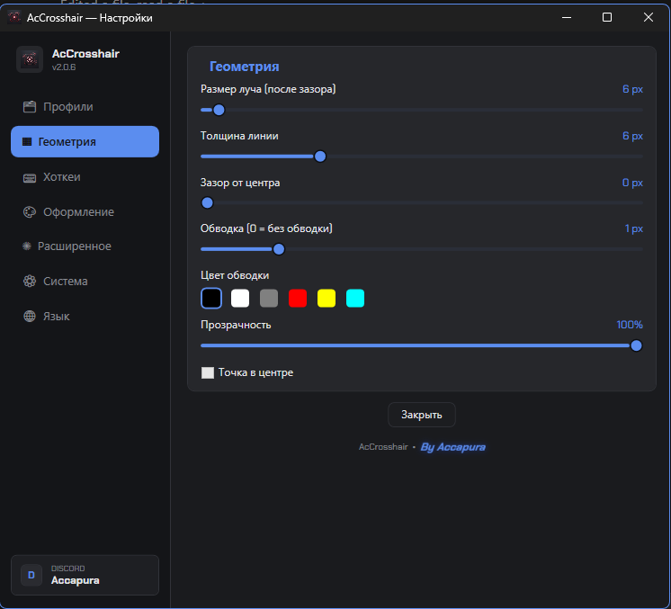
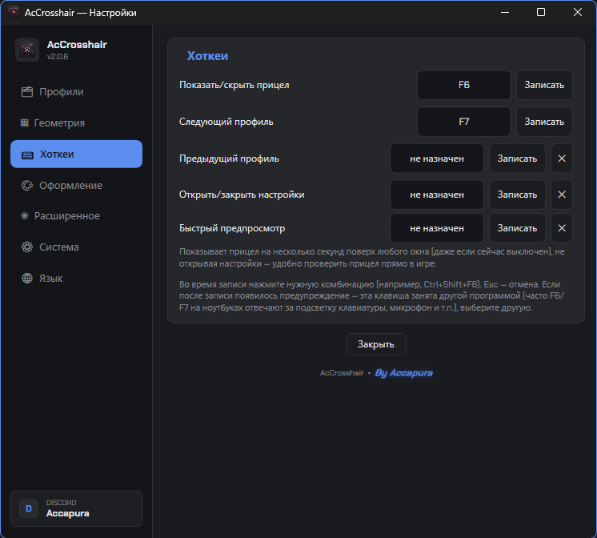
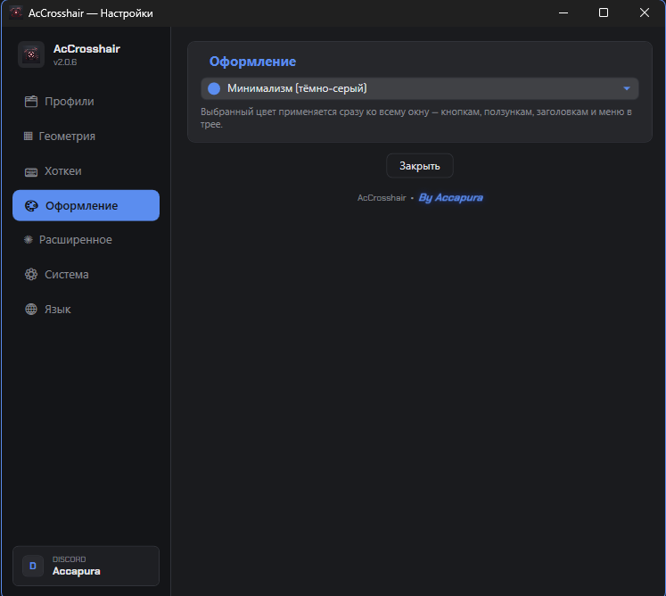
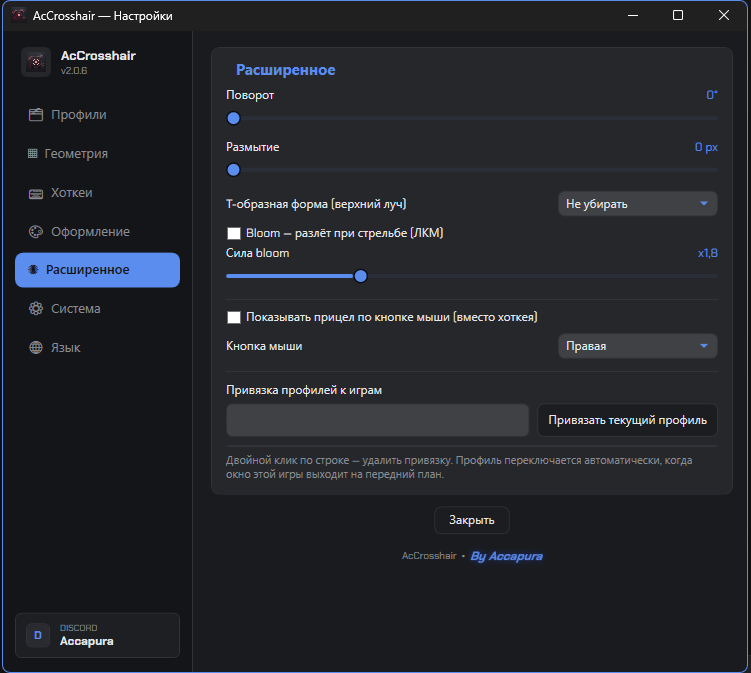
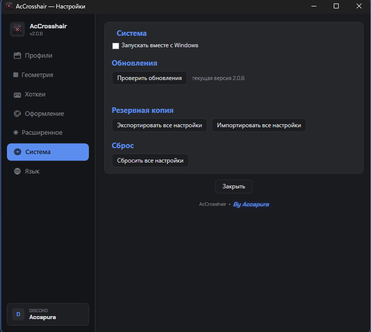
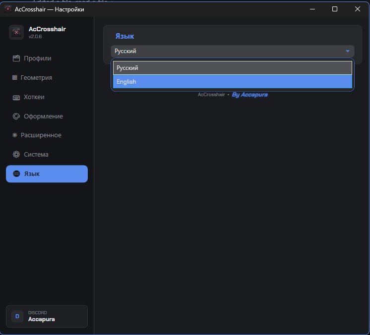

# AcCrosshair

**Лёгкий оверлей-прицел для любой игры и приложения на Windows**

 

---

## О проекте

**AcCrosshair** рисует прицел поверх любого окна или игры — поверх всей системы, независимо от того, есть ли у игры свой прицел и поддерживает ли она оверлеи. Приложение живёт в трее, почти не грузит систему и настраивается полностью под себя: форма, цвет, размер, поведение во время "стрельбы".

Полезно там, где:
- в игре отключён/неудобный системный прицел;
- нужен единый прицел между разными играми;
- хочется точку/крест для прицеливания в приложениях, где прицела нет вовсе.

## Возможности

- 🎯 **9 форм прицела** — точка, крест, круг, X, круг с точкой, квадрат, галочка (^), стрелка вверх, а также линии на весь экран для выравнивания.
- 🗂 **Профили** — неограниченное количество сохранённых прицелов, быстрое переключение, экспорт/импорт в файл.
- 🎨 **Тонкая настройка** — цвет (RGB + HEX), размер, толщина, зазор от центра, точка в центре, обводка, прозрачность, поворот, размытие (blur).
- 💥 **Bloom и T-образная форма** — зазор прицела увеличивается на время зажатой ЛКМ ("стрельба"); верхний луч креста можно убирать всегда/никогда/только во время стрельбы — как в шутерах.
- 🖥 **Выбор монитора** — на каком экране рисуется прицел, при нескольких дисплеях.
- 🎮 **Привязка профиля к игре** — при переключении на окно нужного процесса профиль переключается сам.
- ⌨ **Хоткеи** — показать/скрыть прицел, следующий профиль, быстрый предпросмотр, открытие настроек — либо по кнопке, либо (режим) по зажатию кнопки мыши.
- 🖼 **Фон предпросмотра** — можно подставить скриншот карты/игры прямо в окне настроек, чтобы подбирать прицел "по месту".
- 🌐 **Локализация** — русский и английский интерфейс.
- 🚀 **Автозапуск** и сворачивание в трей с собственным контекстным меню.
- 🪶 Публикуется как один самодостаточный `.exe` — иконка, шрифты и ресурсы зашиты внутрь сборки.

## Что нового в v2.0.6

- 🏹 Новая форма прицела — **стрелка вверх** (залитый треугольник-наконечник, в отличие от галочки это настоящая заливка, а не линии).
- 🔄 Хоткей **"предыдущий профиль"** — теперь можно переключаться не только вперёд.
- 💾 Экспорт/импорт **всех** настроек разом (профили, хоткеи, оформление, привязки к играм) — отдельно от экспорта только профилей.
- ♻️ Сброс всех настроек к значениям по умолчанию одной кнопкой (с подтверждением).
- 🎨 Настраиваемый **цвет обводки** прицела (раньше обводка всегда была чёрной).
- 🔔 Проверка обновлений прямо в приложении — сверяется с последним релизом на GitHub.
- 🐛 Исправлен баг с неверной формой в профиле "Точка".

### Что было в v2.0.5

- 🎨 Редизайн окна настроек — минималистичный тёмно-серый стиль с синим акцентом вместо прежнего "стеклянного" фиолетово-золотого.
- 🗂 Разделы **Предпросмотр / Профили / Форма / Цвет / Экран** объединены в одну страницу «Профили».
- 🖱 Клик по лого открывает репозиторий на GitHub, клик по карточке автора — Discord.
- 🔢 Номер версии теперь показывается прямо в приложении.
- 🐛 Исправлено зависание окна настроек при открытии и локализация бокового меню.

Полная история версий — во вкладке [Releases](https://github.com/Accapura/AcCrosshair/releases).

## Скриншоты

<table>
<tr>
<td align="center" width="33%"> Геометрия</td>
<td align="center" width="33%"> Хоткеи</td>
<td align="center" width="33%"> Оформление</td>
</tr>
<tr>
<td align="center" width="33%"> Расширенное</td>
<td align="center" width="33%"> Система</td>
<td align="center" width="33%"> Язык</td>
</tr>
</table>

## Установка и запуск

1. Скачай последний релиз (`AcCrosshair.exe`) со страницы [Releases](https://github.com/Accapura/AcCrosshair/releases)
2. Запусти `AcCrosshair.exe`. Приложение свернётся в системный трей.
3. Правый клик по иконке в трее → **Настройки...**, чтобы создать и настроить профиль прицела.

## Сборка из исходников

Нужен [.NET 10 SDK](https://dotnet.microsoft.com/download) для Windows.

## Горячие клавиши по умолчанию

| Действие                    | Клавиша |
|------------------------------|:-------:|
| Показать/скрыть прицел       | `F6`    |
| Следующий профиль             | `F7`    |
| Предыдущий профиль            | —       |
| Открыть окно настроек         | —       |
| Быстрый предпросмотр          | —       |

Все хоткеи переназначаются в **Настройки → Хоткеи**.

## Технологии

WPF (.NET 10) + WinForms (трей и `NotifyIcon`), собственный рендер прицела без сторонних графических библиотек, JSON-хранение настроек, глобальный low-level хук мыши/клавиатуры для хоткеев и режима "стрельбы".

## Автор

**Accapura** — [Discord](https://discord.com/users/256419758369538048)

## Лицензия

Проект распространяется для личного некоммерческого использования. По вопросам иного использования — писать автору в Discord.
