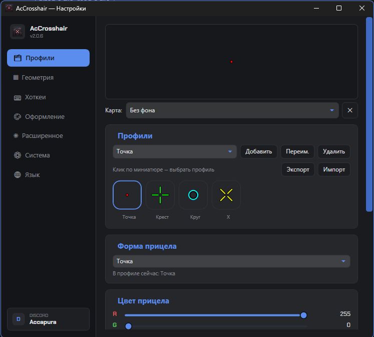

<div align="center">


# AcCrosshair

**Лёгкий оверлей-прицел для любой игры и приложения на Windows**

[](https://github.com/Accapura/AcCrosshair)
[](https://dotnet.microsoft.com/)
[](https://github.com/Accapura/AcCrosshair)
[](#лицензия)
[](#)

<br/>



</div>

---

## О проекте

**AcCrosshair** рисует прицел поверх любого окна или игры — поверх всей системы, независимо от того, есть ли у игры свой прицел и поддерживает ли она оверлеи. Приложение живёт в трее, почти не грузит систему и настраивается полностью под себя: форма, цвет, размер, поведение во время "стрельбы".

Полезно там, где:
- в игре отключён/неудобный системный прицел;
- нужен единый прицел между разными играми;
- хочется точку/крест для прицеливания в приложениях, где прицела нет вовсе.

## Возможности

- 🎯 **8 форм прицела** — точка, крест, круг, X, круг с точкой, квадрат, галочка (^), а также линии на весь экран для выравнивания.
- 🗂 **Профили** — неограниченное количество сохранённых прицелов, быстрое переключение, экспорт/импорт в файл.
- 🎨 **Тонкая настройка** — цвет (RGB + HEX), размер, толщина, зазор от центра, точка в центре, обводка, прозрачность, поворот, размытие (blur).
- 💥 **Bloom и T-образная форма** — зазор прицела увеличивается на время зажатой ЛКМ ("стрельба"); верхний луч креста можно убирать всегда/никогда/только во время стрельбы — как в шутерах.
- 🖥 **Выбор монитора** — на каком экране рисуется прицел, при нескольких дисплеях.
- 🎮 **Привязка профиля к игре** — при переключении на окно нужного процесса профиль переключается сам.
- ⌨ **Хоткеи** — показать/скрыть прицел, следующий профиль, быстрый предпросмотр, открытие настроек — либо по кнопке, либо (режим) по зажатию кнопки мыши.
- 🖼 **Фон предпросмотра** — можно подставить скриншот карты/игры прямо в окне настроек, чтобы подбирать прицел "по месту".
- 🌐 **Локализация** — русский и английский интерфейс.
- 🚀 **Автозапуск** и сворачивание в трей с собственным контекстным меню.
- 🪶 Публикуется как один самодостаточный `.exe` — иконка, шрифты и ресурсы зашиты внутрь сборки.

## Установка и запуск

1. Скачай последний релиз (`AcCrosshair.exe`) со страницы [Releases](https://github.com/Accapura/AcCrosshair/releases) — или собери сам (см. ниже).
2. Запусти `AcCrosshair.exe`. Приложение свернётся в системный трей.
3. Правый клик по иконке в трее → **Настройки...**, чтобы создать и настроить профиль прицела.

## Сборка из исходников

Нужен [.NET 10 SDK](https://dotnet.microsoft.com/download) для Windows.

```bash
git clone https://github.com/Accapura/AcCrosshair.git
cd AcCrosshair/AccapuraCross

# обычная сборка (Debug)
dotnet build

# релизная сборка
dotnet build -c Release

# публикация в один самодостаточный exe
dotnet publish -c Release -r win-x64 --self-contained true -p:PublishSingleFile=true
```

Готовый `AcCrosshair.exe` после `publish` появится в `bin/Release/net10.0-windows/win-x64/publish/`.

## Горячие клавиши по умолчанию

| Действие                    | Клавиша |
|------------------------------|:-------:|
| Показать/скрыть прицел       | `F6`    |
| Следующий профиль             | `F7`    |
| Открыть окно настроек         | —       |
| Быстрый предпросмотр          | —       |

Все хоткеи переназначаются в **Настройки → Хоткеи**.

## Технологии

WPF (.NET 10) + WinForms (трей и `NotifyIcon`), собственный рендер прицела без сторонних графических библиотек, JSON-хранение настроек, глобальный low-level хук мыши/клавиатуры для хоткеев и режима "стрельбы".

## Автор

**Accapura** — [Discord](https://discord.com/users/256419758369538048)

## Лицензия

Проект распространяется для личного некоммерческого использования. По вопросам иного использования — писать автору в Discord.
